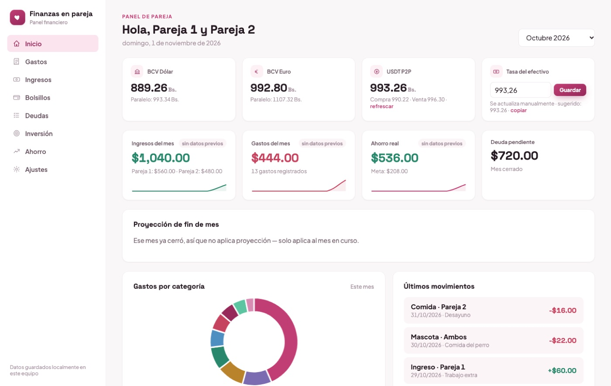
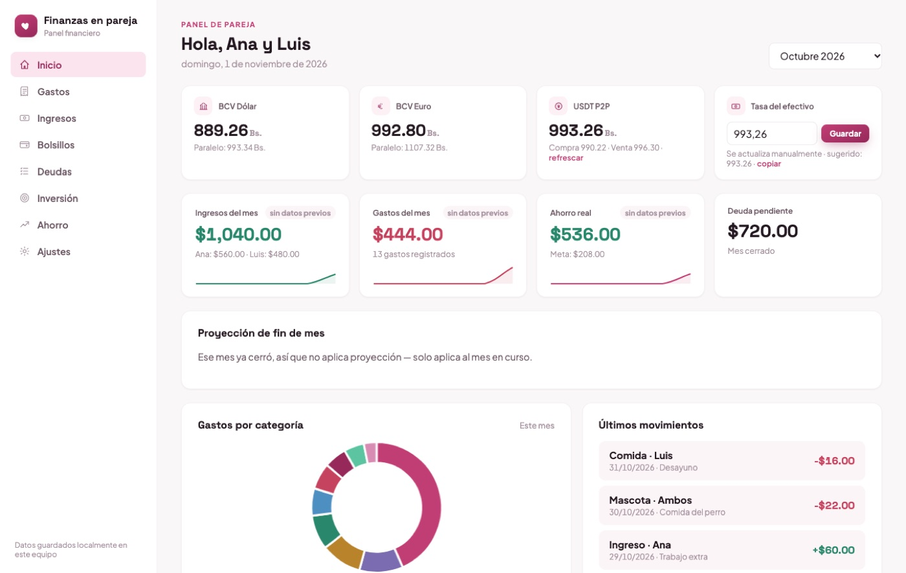
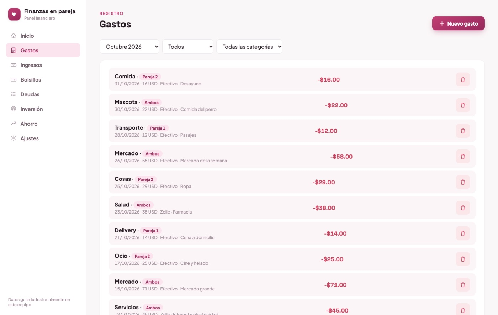
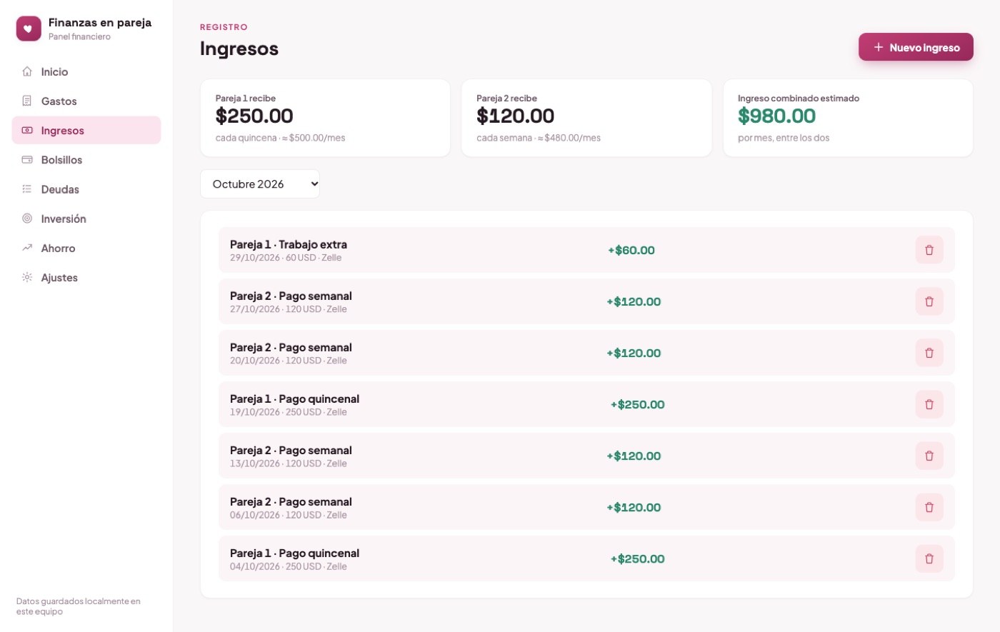
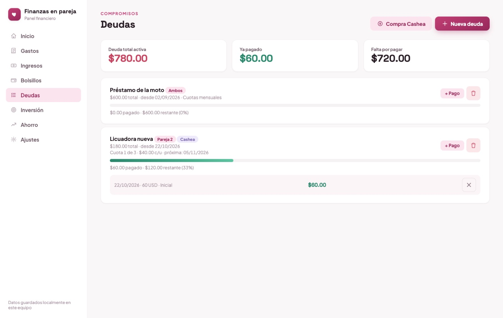
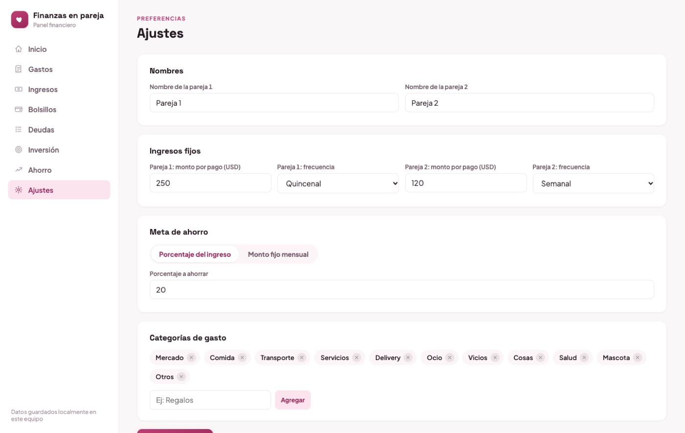
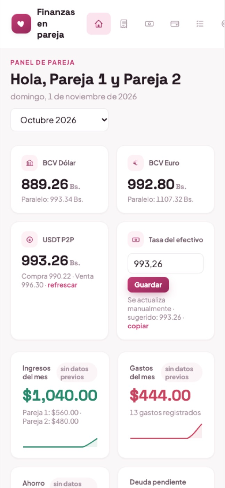

# Finanzas en pareja

<!-- teaser:start -->
<p align="center">
  
</p>

<details><summary>Más capturas</summary>

<p align="center">
   
</p>

</details>
<!-- teaser:end -->


Panel para llevar en pareja el control de gastos, ingresos, bolsillos, deudas, inversión y ahorro, con las tasas de cambio de Venezuela en tiempo real. Funciona desde el teléfono y guarda todo en una base de datos SQLite remota (Turso).

> Los datos de las capturas son de demostración. Los nombres de la pareja son **editables**: se cambian en *Ajustes → Nombres* y se reflejan en todo el panel.

## Qué hace

- **Gastos e ingresos** por persona, bolsillo y categoría, con monto en USD, VES, EUR o USDT y conversión con la tasa del día.
- **Bolsillos** (efectivo, Zelle, USDT, cuentas) con saldo calculado.
- **Deudas** con pagos parciales y **compras en cuotas estilo Cashea** (inicial más cuotas iguales cada 14 días).
- **Inversión y ahorro**: meta por porcentaje o por monto fijo, y proyección a 6 meses.
- **Proyección de fin de mes** combinando el ritmo actual con el promedio de los últimos meses.
- **Fotos de facturas** adjuntas a cada movimiento (Vercel Blob).
- Acceso con una sola contraseña compartida, sesión de 90 días por dispositivo.

## Stack

Node.js sin framework en el servidor · JavaScript, HTML y CSS en el cliente (gráficas propias) · libSQL / Turso · Vercel (funciones y hosting) · Vercel Blob.

## Correrlo en local

No necesita cuentas: libSQL acepta un archivo como base de datos.

```bash
npm install
TURSO_DATABASE_URL=file:./data/finanzas.db npm start
```

Abre http://localhost:4173 (o el puerto de `PORT`). En local no pide contraseña.

## Publicarlo (Vercel + Turso)

1. Crea una base en [Turso](https://turso.tech) y copia su URL y su token.
2. Importa este repositorio en [Vercel](https://vercel.com) y conecta un almacén **Blob** privado (agrega `BLOB_READ_WRITE_TOKEN`).
3. En *Settings → Environment Variables* agrega: `TURSO_DATABASE_URL`, `TURSO_AUTH_TOKEN`, `APP_PASSWORD` (la contraseña que usarán) y `SESSION_SECRET` (un texto largo y aleatorio, por ejemplo `openssl rand -hex 32`).
4. Despliega. La app pide la contraseña una vez por dispositivo.

Hay un ejemplo de variables en `.env.example`.
